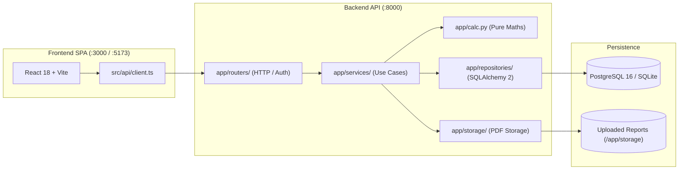

# MetalOps Lite

Scrap purchasing, furnace heats, sales and spectro reports for a small aluminium recycling workshop. Computes yield, landed costs, and profit per heat, always **excluding GST**.

[](https://github.com/KushagraPan/Metal-Ops/actions/workflows/ci.yml)
[](LICENSE)

---

## 1. Problem & Purpose

Small aluminium recycling workshops buy scrap aluminium (extrusions, cast, taint/tabor), melt it in batch furnace operations called **heats**, and sell alloy ingots (ADC12 or LM6) alongside byproducts (dross and iron scrap).

When managed in ad-hoc spreadsheets:
- Historical yield and profit per heat cannot be tracked reliably.
- Chemical composition (spectro) PDF reports are separated from furnace heat records.
- GST credits and transport freight costs are applied inconsistently, distorting actual profit margins.

**MetalOps Lite** centralizes workshop operations into a single operational system that tracks intake, furnace melts, sales, and quality reports while enforcing exact financial rules.

---

## 2. Key Features & Business Rules

All financial calculations follow the formal rules **R1–R13** in [`product-spec.md`](product-spec.md):

| Domain Area | Key Capabilities & Rules |
|---|---|
| **Scrap Purchases** | Inward scrap intake tracking weight (kg), rate (₹/kg), GST mode (`WITH` or `WITHOUT`), and transport freight (`SUPPLIER_DELIVERS` or `WE_PAY`). Automatically calculates ex-GST landed cost per kg (`R3`). |
| **Furnace Heats** | Batch tracking recording consumed lots, duration, production output kg, dross kg, iron scrap kg, and variable run costs (oil, power, labour, other). Enforces stock availability guardrails (`R4`) preventing overconsumption. |
| **Metal Sales** | Alloy ingot sales (ADC12 or LM6) bound to specific heats, plus byproduct sales (dross, iron scrap). Supports 3 freight arrangements (`CUSTOMER_ARRANGES`, `WE_PAY_ABSORB`, `WE_PAY_BILL`) and derives net outbound transport (`R6`). |
| **Spectro Reports** | Upload, list, and download chemical analysis PDF reports linked to heats. Enforces magic-byte signature validation (`%PDF`), random UUID storage keys, and authenticated streaming downloads (`R13`). |
| **Workshop Analytics** | Yield percentage (`R5`), profit per heat (`R7`), provisional profit labelling (`R8`), monthly fixed expenses allocation (`R10`), break-even heat targets (`R11`), and net GST liability estimation (`R12`). |
| **Settings** | Configurable workshop settings: default GST rate (default 18%) and planned furnace yield target (default 89%). |

### Core Financial Principles
1. **Money is Always ex-GST (`R1`)**: GST collected or paid never affects profit calculations. Switching GST modes changes invoice tax balances, never operational margins.
2. **Landed Cost (`R3`)**: Inbound freight paid by the workshop is capitalized directly into lot scrap cost: `(kg × rate + inbound transport) ÷ kg`.
3. **Provisional Profit (`R8`)**: A heat's profit remains marked as `provisional` until all output alloy ingots are sold.
4. **Zero Floating-Point Math**: All calculations strictly use Python `Decimal` and SQL `Numeric(12,2)`. Binary `float` is prohibited.

---

## 3. Technology Stack

- **Backend**: FastAPI 0.162 · Python 3.11 · SQLAlchemy 2.0 · Alembic 1.14 · Pydantic v2 · pytest 9.0 · Uvicorn
- **Frontend**: React 18 · TypeScript 5.6 · Vite 5.4 · Vitest 5.0 · Tailwind CSS 3.4 · shadcn/ui · Recharts 2.15 · Lucide Icons
- **Database & Storage**: PostgreSQL 16 (production/Docker) · SQLite (local fast development) · Named Docker volume for PDFs
- **Observability**: OpenTelemetry SDK 1.45 · OpenTelemetry Collector 0.165 · Prometheus 3.16 · Grafana Loki 3.6 · Grafana Tempo 2.9 · Grafana 11.4 · Alertmanager 0.28
- **DevOps & CI/CD**: Docker Compose (v2) · Nginx 1.27 Alpine · GitHub Actions · Trivy Container Scanner · Gitleaks · Pip-Audit · NPM Audit

---

## 4. Architecture Overview



For full details on layering, security boundaries, and data models, see [`_docs/architecture.md`](_docs/architecture.md).

---

## 5. Prerequisites

Before running MetalOps Lite locally, ensure you have:
- **Python**: Version 3.11 or higher (`python --version`)
- **Node.js**: Version 20 or 22 LTS (`node --version`, `npm --version`)
- **GNU Make**: Version 3.81 or higher (`make --version`)
- **Docker & Docker Compose**: Docker Engine 24+ with Compose v2 (required for containerized runs)

---

## 6. Environment Setup & Configuration

1. Clone the repository and enter the directory:
   ```bash
   git clone https://github.com/KushagraPan/Metal-Ops.git
   cd Metal-Ops
   ```

2. Create your local environment file:
   ```bash
   cp .env.example .env
   ```

3. Configure essential variables in `.env`:
   ```ini
   ENV=development
   OWNER_EMAIL=owner@workshop.local
   OWNER_PASSWORD=ValidPassword123!
   FRONTEND_PORT=3000
   GRAFANA_ADMIN_PASSWORD=local_grafana_password
   ```

---

## 7. Local Development Instructions

The repository provides automated `Makefile` targets for setting up and running the application locally:

### 1. Install Dependencies
```bash
make install
```
*Creates the Python virtual environment under `.venv`, installs all pinned requirements, and installs frontend npm packages.*

### 2. Setup Database & Demo Seed Data
```bash
make seed
```
*Applies Alembic migrations (`make migrate`) to the local SQLite database and seeds fictional demo data: purchase lots, furnace heats, alloy sales, fixed expenses, and sample spectro reports.*

To reset the local database at any time:
```bash
make reset-db
```

### 3. Start Development Servers
```bash
make dev
```
*Launches both services concurrently:*
- **Backend API**: [http://127.0.0.1:8000](http://127.0.0.1:8000) (Interactive Swagger Docs at `/docs`)
- **Frontend UI**: [http://127.0.0.1:5173](http://127.0.0.1:5173)

Log in with:
- **Email**: `owner@workshop.local` (or value in `OWNER_EMAIL`)
- **Password**: `ValidPassword123!` (or value in `OWNER_PASSWORD`)

---

## 8. Running Automated Tests

All tests can be executed locally using GNU Make:

| Test Command | Scope & Framework | Verification Details |
|---|---|---|
| `make test` | **Full Test Suite** | Executes unit tests, integration tests, Vitest suite, and TypeScript typechecking (`tsc --noEmit`). |
| `make test-unit` | **Unit Tests Only** | Runs `pytest tests/unit` covering `app/calc.py`, domain validations, telemetry allowlists, and route rules. |
| `make test-integration` | **Integration Tests** | Runs `pytest tests/integration` against a real database instance verifying concurrent row locking (`FOR UPDATE`). |
| `cd frontend && npm test` | **Frontend Unit Tests** | Executes Vitest unit tests across React pages, components, and formatters. |
| `make rollback-test` | **Deployment Rollback** | Verifies container rollback mechanics and database persistence. |

---

## 9. Running with Docker Compose

To run the complete production-grade stack (PostgreSQL database, FastAPI backend, and Nginx reverse proxy):

### Start the Stack
```bash
docker compose up -d --build
```
Access the application at [http://127.0.0.1:3000](http://127.0.0.1:3000).

### Volume Persistence & Lifecycle
- **Stop containers (preserve data)**:
  ```bash
  docker compose down
  ```
  *Database records and uploaded spectro reports are safely retained in Docker named volumes (`metalops_postgres_data` and `metalops_uploads`).*
- **Tear down with volume deletion (wipe data)**:
  ```bash
  docker compose down -v
  ```

### Stack Verification Targets
```bash
make stack-up           # Start Compose stack with test database exposed
make stack-test         # Run integration test suite against running containers
make stack-persistence  # Verify report file persistence across container restart
make stack-down         # Tear down test stack
```

---

## 10. Observability & Alerting Stack

An optional observability profile adds OpenTelemetry Collector, Prometheus, Loki, Tempo, and Grafana:

1. **Start Observability Stack**:
   ```bash
   docker compose -f compose.yaml -f compose.observability.yaml --profile observability up -d --build --wait
   ```
2. **Access Grafana**:
   Open [http://127.0.0.1:3001](http://127.0.0.1:3001) and sign in as `admin` with `GRAFANA_ADMIN_PASSWORD` from `.env`.
   - **Dashboard**: Open **MetalOps → MetalOps key journey** to view request rates, latencies, and upload volumes.
   - **Explore Traces & Logs**: Open **Explore → Loki** or **Tempo** to query distributed spans and logs joined by `trace_id`.
3. **Stop Observability Services**:
   ```bash
   docker compose -f compose.yaml -f compose.observability.yaml --profile observability down
   ```

---

## 11. Deployment Procedure & CI/CD

Deployment is automated via GitHub Actions ([`.github/workflows/cd.yml`](.github/workflows/cd.yml)) targeting single-host VMs with Docker Compose:

### Deployment Pipeline
1. **Merge to `main`**: Builds immutable container images tagged with the commit SHA (`ghcr.io/kushagrapan/metal-ops-backend:<sha>` and `metal-ops-frontend:<sha>`) and automatically deploys to the `development` environment.
2. **Production Deployment Gate**: Deployments to `production` target the GitHub `production` environment and require explicit manual review and approval from designated reviewers.
3. **Rollback Procedure**:
   If an issue occurs in production, rollback is executed by redeploying the prior commit SHA:
   ```bash
   IMAGE_TAG=<previous_commit_sha> docker compose -f compose.prod.yaml up -d --remove-orphans
   ```

### Required Deployment Secrets
Configure these secrets in GitHub Repository Settings:
- `DEPLOY_HOST`: Hostname or IP address of the target VM.
- `DEPLOY_USER`: SSH user with Docker Compose access.
- `DEPLOY_SSH_KEY`: Private SSH key authorized in the VM's `~/.ssh/authorized_keys`.
- `OWNER_PASSWORD`: Production workshop admin password (minimum 10 characters).

---

## 12. Project Documentation Directory

| Document | Content & Purpose |
|---|---|
| [`product-spec.md`](product-spec.md) | **Frozen Product Specification**: Complete mathematical rules R1–R13, data model, screen requirements, and worked financial fixture. |
| [`_docs/architecture.md`](_docs/architecture.md) | **Architecture Guide**: Detailed request flow, backend layering, data model, frontend structure, security, and observability. |
| [`_docs/agent-team.md`](_docs/agent-team.md) | **Agent Team Governance**: Roles (Spec, Implementer, QA, Responder, Reviewer), lifecycle, handoff contracts, and boundaries. |
| [`_docs/ai-tools-usage.md`](_docs/ai-tools-usage.md) | **AI Tools Usage Log**: Record of AI models used, tasks assisted, human verification responsibilities, and limitations encountered. |
| [`_docs/oncall-agent.md`](_docs/oncall-agent.md) | **On-Call Responder**: Automated incident triage design, guardrails, controlled remediation drill evaluation, and acceptance status. |
| [`_docs/backlog.md`](_docs/backlog.md) | **Issue Backlog**: Issues #1 through #22 detailing priorities, dependencies, and observable acceptance criteria. |
| [`AGENTS.md`](AGENTS.md) | **Developer & Agent Working Agreement**: Code conventions, safety rules, and definition of done. |
