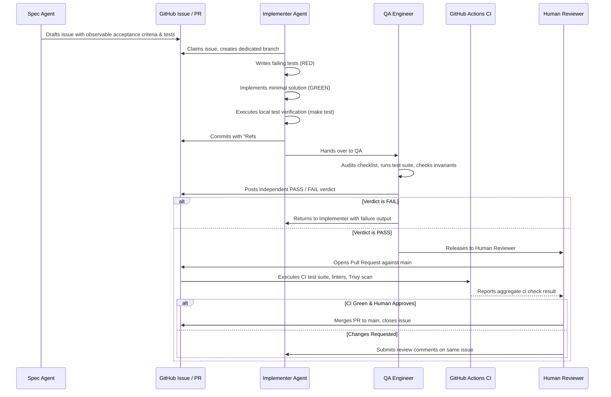

# Agent Team & Governance

This document defines the roles, responsibilities, permissions, execution boundaries, and hand-off contracts governing collaboration between AI agents and human reviewers across the **MetalOps Lite** lifecycle.

---

## 1. Roster of Roles

| Role | Primary Actor | Execution Environment | Permissions & Authority | Prohibited Actions |
|---|---|---|---|---|
| **Spec Agent** | Claude 3.7 / 3.5 Sonnet | Chat Session | Owns the specification (`product-spec.md`) and issue descriptions (`_docs/backlog.md`). | Must never write application code, create commits, or modify specs during an active implementation. |
| **Implementer** | DeepSeek V4 / Gemini Pro | OpenCode / Antigravity Harness | Implements one issue at a time test-first. Authors tests, domain logic, migrations, and frontend code. | Must not modify `product-spec.md`, widen scope beyond acceptance criteria, push directly to `main`, or self-merge. |
| **QA Engineer** | Verification Agent | Isolated Read-Only Session | Exercises criteria against running code, runs tests, and posts independent PASS/FAIL verdicts. | Must not modify application code, merge pull requests, or close issues. |
| **On-Call Responder** | Automated Headless Worker | Docker / Webhook Boundary | Wakes on 5xx alerts, correlates Loki/Tempo traces, evaluates fixes in isolated worktrees, opens candidate PRs. | Strictly forbidden from accessing production secrets (`PRODUCTION_*`, `DEPLOY_*`), running shell commands, or self-merging. |
| **Human Reviewer** | Workshop Owner / Lead Engineer | GitHub Web UI / Terminal | Reviews diffs, audits QA evidence, validates deployments, and merges pull requests into `main`. | Sole role with merge authority. |

---

## 2. Issue Lifecycle & Hand-off Pipeline

Every unit of work corresponds to exactly one GitHub issue with clear, observable acceptance criteria. Work progresses through a strict sequential pipeline:

---

## 3. Detailed Role Contracts & Execution Boundaries

### A. Spec Agent
- **Responsibilities**: Translate workshop business requirements into formal, numbered rules (R1–R13) and observable acceptance criteria.
- **Inputs**: Client interview notes, workshop accounting spreadsheets, and feedback.
- **Outputs**: `product-spec.md`, `_docs/backlog.md`, and GitHub issue definitions.
- **Tools**: Markdown editor.
- **Handoff Gate**: An issue is ready only when acceptance criteria can be verified through explicit, automated or behavioural tests.

### B. Implementer
- **Responsibilities**:
  1. Author failing unit/integration tests before writing domain code.
  2. Implement the smallest code change that satisfies the test suite.
  3. Keep all financial calculations inside `app/calc.py` as pure functions of `Decimal`.
  4. Ensure zero floating-point math in money or weight columns.
- **Inputs**: Authoritative GitHub issue criteria.
- **Outputs**: Scoped Git commits on a dedicated issue branch, ending with `Refs #N`.
- **Handoff Gate**: Local verification (`make test`) must pass completely before handing over to QA.

### C. QA Engineer (Verification Agent)
- **Responsibilities**:
  1. Extract acceptance criteria directly from the issue checklist before inspecting diffs.
  2. Independently execute `make test` and record command outputs.
  3. Verify database idempotency (`make seed` executed twice returns identical entity counts).
  4. Audit for scope creep, ensuring zero edits to `product-spec.md` and zero committed credentials.
- **Inputs**: Implementer's summary comment and commit SHA.
- **Outputs**: Formatted QA verdict comment (`QA: PASS` or `QA: FAIL`) citing itemized evidence.
- **Contract**: Defined in detail in [`_docs/team/qa-engineer.md`](team/qa-engineer.md).

### D. On-Call Responder (Issue #18)
- **Responsibilities**:
  1. Wake on HTTP webhook alert payloads delivered by the Prometheus/Alertmanager pipeline.
  2. Deduplicate alerts via atomic SQLite transactions (`claim_alert`) in WAL mode.
  3. Correlate Loki logs and Tempo trace IDs without logging sensitive customer or rate data.
  4. Execute all diagnostic tests and candidate patch authoring in an isolated Git worktree (`metalops-oncall-worktrees/wt-...`).
  5. Open a candidate PR using an isolated, temporary GitHub CLI directory (`GH_CONFIG_DIR`) and `ONCALL_GITHUB_TOKEN`.
- **Restrictions & Security Boundaries**:
  - **No Production Secrets**: Subprocess execution strictly purges `DEPLOY_SSH_KEY`, `PROD_DATABASE_URL`, and all environment variables prefixed with `PRODUCTION_*` or `PROD_*`.
  - **No Shell Execution**: Subprocess calls require `shell=False`; shell wrappers (`sh`, `bash`, `cmd`, `powershell`) and chaining metacharacters (`;`, `&&`, `|`) are blocked by `GuardrailEnforcer`.
  - **No Merge Authority**: Branch protection and required status checks prevent automated merging. PRs must remain `OPEN` for human review.
- **Current Operational Status**:
  > [!WARNING]
  > **Issue #18 Status: OPEN / NOT ACCEPTED**
  > While deterministic guardrails, worktree isolation, and token isolation are verified, autonomous defect diagnosis and patch authoring have **NOT** met acceptance criteria. In controlled drills using local models (`qwen2.5-coder:1.5b`), the model failed to autonomously localize the defect or generate an automated reproduction test. All candidate PRs (#28, #30) remain unmerged and under human review. Full evaluation records are maintained in [`_docs/oncall-agent.md`](oncall-agent.md).

### E. Human Reviewer
- **Responsibilities**:
  - Validate that the pull request satisfies the business specification without unintended regressions.
  - Audit CI security reports (Gitleaks, Trivy container scans, pip-audit, npm audit).
  - Perform the final merge into `main` and trigger production CD deployment.
- **Authority**: Holds the sole deployment and merge credentials.

---

## 4. Hand-off Artifact & Evidence Matrix

| Transition | Required Artifact | Verification Gate |
|---|---|---|
| **Spec → Implementer** | GitHub issue with acceptance criteria and test plan | Observable, testable criteria; dependencies merged into `main`. |
| **Implementer → QA** | Scoped commits (`Refs #N`) + summary comment | `make test` green locally; zero diff in `product-spec.md`. |
| **QA → Reviewer** | Independent QA verdict comment (`PASS`/`FAIL`) | Every criterion audited; exact test commands recorded. |
| **Implementer → CI** | GitHub Pull Request | Triggers automated GitHub Actions matrix (`ci.yml`). |
| **CI → Reviewer** | Green aggregate `ci` check status | Zero test failures, zero lint/type errors, zero HIGH/CRITICAL vulnerabilities. |
| **Alert → Responder** | Sanitized alert JSON (`metric`, `service`, `trace_ids`) | Validated against allowlisted schema; claimed via atomic SQLite lock. |
| **Responder → Reviewer** | OPEN Pull Request on `oncall/*` branch | Pre-fix reproduction test failure verified; post-fix pass verified; no production write access. |
