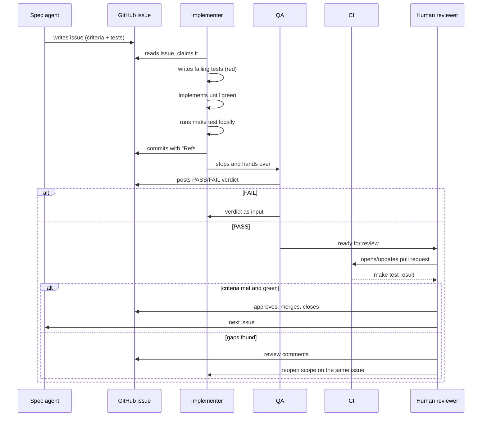

# Agent Team

How the work on MetalOps Lite is divided between humans and AI agents, and how artefacts move between them. `AGENTS.md` holds the short rules; this document holds the full process.

## Roster

| Role | Actor | Authority | Writes |
|---|---|---|---|
| **Spec agent** | Claude, in chat | Owns the specification and the issue text. May change them between issues, never during one. | `product-spec.md`, `_docs/backlog.md`, issue bodies |
| **Implementer** | DeepSeek V4 in OpenCode | Implements exactly one issue at a time, test-first. Cannot widen scope, cannot change the spec, cannot merge. | `app/`, `frontend/`, tests, migrations, the files the issue names |
| **QA** | Verification agent, separate from the implementer | Checks a finished issue against its acceptance criteria and posts a PASS/FAIL verdict. Cannot fix, merge or close. | Verdict comment on the issue |
| **Reviewer** | Human | Approves or rejects each issue. Merges pull requests. The only role that can accept work. | Review comments, merge commits |
| **Responder** | Headless agent, issue #18 | Wakes on an alert, investigates, opens a fix pull request. No production access, never merges. | A branch, a pull request, `_docs/oncall-agent.md` |
| **CI** | GitHub Actions | Not an agent, a gate. Runs `make test` on every pull request and blocks merge on failure. | Checks, build logs |

The course peer reviewer is outside this team: they score the submitted repository against the criteria in the project brief and cannot be influenced by the team.

## The unit of work

One GitHub issue. The issue is authoritative; `_docs/backlog.md` mirrors it. Every issue carries:

- a priority (`P0` or `P1`) and dependency list;
- acceptance criteria written as observable behaviour;
- the tests that must exist before the issue is done.

An issue with no acceptance criteria is not ready to start. If the implementer finds one, it comments on the issue and stops.

## Lifecycle of one issue

### 1. Specify

The spec agent writes the issue from `product-spec.md`, with rules referenced by number (for example "R4 stock guard"). It does not write application code.

### 2. Implement

The implementer reads the whole issue, including acceptance criteria, then:

1. writes the tests named in the issue and watches them fail;
2. writes the smallest implementation that makes them pass;
3. runs `make test` — unit and integration together;
4. commits in small steps, each message ending with `Refs #N`;
5. comments on the issue: what changed, how it was tested, anything surprising;
6. stops and hands the issue to QA. It does not pick up the next issue.

### 3. Verify

The QA agent checks the finished issue against its acceptance criteria and posts a PASS/FAIL verdict. A FAIL returns the issue to the implementer with the verdict as input; a PASS releases it to the human reviewer. QA changes no code.

### 4. Review

The human reads the diff against the acceptance criteria, checks for unrelated changes, and either merges or sends the issue back. A merge is the only signal that the next issue may start.

### 5. Respond

On an alert, the responder follows `_docs/oncall-agent.md`: read the logs and traces for the failing trace ID, reproduce, write a failing test, fix, open a pull request. It stops there.

## Hand-off contract

Each hand-off has an artefact and a gate. If the artefact is missing, the next role does not proceed.

| From → To | Artefact | Gate |
|---|---|---|
| Spec → Implementer | Issue with criteria and named tests | Criteria are observable; dependencies merged |
| Implementer → QA | Issue comment and commits | States what changed, how it was tested, and any risk; tests green |
| QA → Reviewer | PASS/FAIL comment | Every criterion has a verdict; each FAIL states expected vs actual |
| Implementer → CI | Branch and pull request | `make test` green locally |
| CI → Reviewer | Check result | All tests pass; no skipped tests hiding failures |
| Reviewer → Implementer | Merge or review comments | Criteria met and no unrelated changes |
| Alert → Responder | Alert payload with service, window and trace IDs | Threshold from issue #17 crossed |
| Responder → Reviewer | Pull request with a new failing-then-passing test | CI green; no production write access used |

## Boundaries

- The implementer never edits `product-spec.md`. A suspected spec error is an issue comment, not an edit.
- No role merges its own work. The responder has no production access at all.
- No role adds a library, a screen or a file that the issue does not name.
- No role commits real business data, credentials or customer names.
- Telemetry is written by the application, but every role is bound by the same allow-list: IDs, durations and sizes only — never names, rates, amounts or file contents.

## Evidence the team worked

The tracker is the record, not the chat. For each closed issue the repository holds:

1. the issue with its acceptance criteria;
2. commits referencing it (`Refs #N`);
3. the implementer's summary comment;
4. the QA verdict comment;
5. the review outcome.

`git log --grep 'Refs #'` must show one or more commits per closed issue. An issue closed without them is treated as unverified.

## Escalation

| Situation | Action |
|---|---|
| Spec is ambiguous or wrong | Comment on the issue with the exact rule and stop |
| Acceptance criterion is untestable | Propose a measurable restatement on the issue; wait for the spec agent |
| Test is flaky or a dependency is down | Comment with the failing output; do not weaken or skip the test |
| Scope grows mid-issue | Split it into a new issue; do not absorb it |
| Alert fires during an active issue | Responder handles it in its own pull request; the implementer does not switch tasks |

## Current state

Wave 0 and issues #1–#2 are complete and verified. The next action is issue #3, the calculation module.
