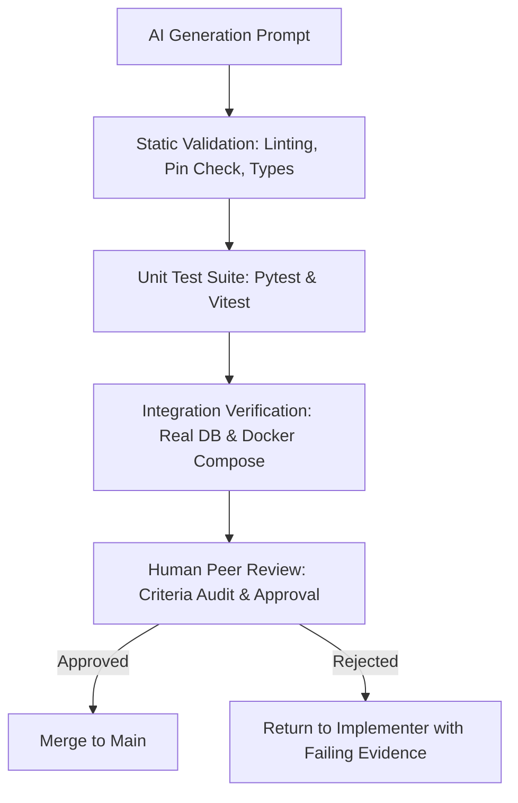

# AI Tools Usage Log

This document records the artificial intelligence models, developer tools, and workflows utilized across the implementation, verification, and on-call automation of **MetalOps Lite**.

In accordance with project governance, this log distinguishes **empirically verified usage** from design assumptions, details the human-in-the-loop verification guardrails, and records specific limitations and failures encountered during autonomous execution.

---

## 1. Roster of AI Models & Developer Tools

| Tool / Model | Interface | Project Role | Scope of Work |
|---|---|---|---|
| **Claude 3.7 Sonnet / Claude 3.5 Sonnet** (Anthropic) | Chat UI / OpenCode Session | **Spec Agent & Co-Architect** | Authored initial frozen specification (`product-spec.md`), backlog issues (#1–#18), modular architecture design (`_docs/architecture.md`), and issue review contracts. |
| **DeepSeek V3 / V4** (DeepSeek) | OpenCode Agent Harness | **Implementer Agent** | Test-driven implementation of backend domain logic, SQLAlchemy 2 repositories, FastAPI routers, Alembic migrations, and React/Tailwind frontend screens (Issues #1–#13). |
| **Gemini 2.5 / 2.0 Flash & Pro** (Google DeepMind) | Antigravity Agent Harness | **Implementer & Verification Agent** | Hardening of CI/CD pipelines (Issues #14, #15), OpenTelemetry instrumentation & Compose observability stack (Issue #16), Prometheus alert rules & webhook adapter (Issue #17), and On-Call deterministic worker implementation (Issue #18). |
| **Qwen 2.5 Coder (1.5B)** (Alibaba / Ollama) | Local Subprocess (`/v1/chat/completions`) | **On-Call Candidate Model (Evaluated)** | Evaluated in Issue #18 as an offline, zero-network candidate model for automated triage, reproduction test authoring, and patch generation. |

---

## 2. Tasks Assisted by AI

### A. Specification & Domain Modeling
- Mathematical formalization of the 13 business rules (R1–R13), specifically pure-function separation for ex-GST landed cost (`R3`), stock consumption guardrails (`R4`), yield calculations (`R5`), net outbound transport deductions (`R6`), and break-even heat derivations (`R11`).
- Design of the unified worked test fixture in `product-spec.md` with zero float representations (`Decimal` and `Numeric(12,2)` throughout).

### B. Test-Driven Development (TDD)
- Authoring unit test suites (`tests/unit/test_calc.py`) covering all permutations of inbound and outbound freight modes (`SUPPLIER_DELIVERS`, `WE_PAY`, `WE_PAY_ABSORB`, `WE_PAY_BILL`, `CUSTOMER_ARRANGES`) and GST modes (`WITH`, `WITHOUT`).
- Generating mock fixtures for PDF signature verification (`%PDF` magic byte headers) and negative security tests (`tests/unit/test_telemetry.py`) verifying zero telemetry leaks of sensitive business names, rates, and amounts.

### C. DevOps & Infrastructure Configuration
- Crafting GitHub Actions workflow matrices (`ci.yml`, `cd.yml`) with top-level read-only permissions, full-commit SHA action pinning, and multi-stage container vulnerability scanning via Trivy.
- Configuring the Docker Compose observability stack (`compose.observability.yaml`) with OpenTelemetry Collector, Prometheus, Loki, Tempo, and Grafana.

---

## 3. Human Review & Verification Responsibilities

At no point was AI granted autonomous write or merge authority over production systems or the `main` branch. The governance follows strict human-in-the-loop boundaries:

1. **Human Authority as Single Source of Truth**:
   - Only human reviewers possess merge permissions on GitHub pull requests.
   - All PRs require the aggregate `ci` status check to pass before merging is permitted.
2. **Deterministic Pre-Execution Verification**:
   - Before executing code proposed by agents, humans and automated harnesses execute static analysis (`scripts/check_pins.py`, `npm audit`, `pip-audit`, `tsc --noEmit`).
3. **Execution Sandboxing**:
   - The on-call agent execution boundary forbids shell execution (`shell=True`), shell metacharacters (`;`, `&&`, `|`), and any commands outside the allowlist (`git`, `gh`, `python`, `pytest`, `make`).
   - All candidate patches authored by agents execute in disposable Git worktrees (`metalops-oncall-worktrees/wt-...`).

---

## 4. Empirical Examples of AI-Assisted Development

### Example 1: Pure Mathematical Functions (`app/calc.py`)
- **Assisting Model**: Claude 3.5 Sonnet / Gemini.
- **Task**: Implement pure functions for R1–R12 using Python `Decimal` with banker's rounding (`ROUND_HALF_UP`) and explicit division-by-zero suppression.
- **Validation**: Verified against the worked fixture in `product-spec.md` Section 5. 82 unit tests passed in 0.20s with 0 float dependencies.

### Example 2: Deny-by-Default Telemetry Allowlist (`app/telemetry.py`)
- **Assisting Model**: Gemini.
- **Task**: Create OpenTelemetry span and metric filters that enforce a strict allowlist of attribute keys, dropping request bodies, query strings, file names, and rates.
- **Validation**: Validated with exact set equality assertions in `tests/unit/test_telemetry.py`, injecting deliberate canary strings (`Acme Scrap Ltd`, `₹200/kg`) and asserting zero presence across emitted spans and Prometheus metric labels.

---

## 5. Limitations, Failures & Lessons Learned

Autonomous agent workflows revealed specific structural failure modes when dealing with complex debugging and small local language models:

### 1. Hallucination and Diff Syntax Corruption in Small Models
- **Context**: In Issue #18 Milestone 4, the 1.5-billion parameter local model `qwen2.5-coder:1.5b` was evaluated for automated incident response via Ollama.
- **Failure**:
  - In an uncoached drill (clean `main` with an injected CRLF regression in `app/services/reports.py:_clean_notes()`), the model **completely failed** to diagnose the defect from telemetry and source files. Instead, it hallucinated an unrelated missing check on `sample_no` inside `update()`.
  - When given a reproduction test task, the model outputted conversational prose instructions rather than executable pytest code.
  - The patch was rejected immediately by the worker's guardrail diff validator (`DiffValidationError`).
- **Lesson**: Sub-3B parameter code models are incapable of zero-shot autonomous root-cause analysis and unified diff synthesis without extensive fine-tuning or structured scaffolding.

### 2. Prompt Leakage and Inadvertent Solution Coaching
- **Context**: During initial Issue #18 testing, earlier runs included hints regarding the expected fix in prompt evidence, giving a false appearance of autonomous repair.
- **Resolution**: The benchmark was rebuilt into a controlled remediation drill where only raw alert metadata (metric, route group, window, trace IDs) and raw source files were provided. The model's failure was recorded honestly in `_docs/oncall-agent.md`.

### 3. Git Diff Line-Ending Drift on Windows
- **Context**: Applying unified diffs via `git apply` in isolated worktrees failed when CRLF line endings in Windows checkouts drifted from LF patch headers.
- **Resolution**: Hardened the deterministic worker in `worker.py` to enforce `--ignore-whitespace` and `--recount` on `git apply`.

---

## 6. Validation Methodology for AI Deliverables

Every AI-generated artifact in MetalOps Lite underwent a 4-tier verification ladder before acceptance:

1. **Static Analysis**: `scripts/check_pins.py` verified exact package pins; `tsc --noEmit` verified TypeScript strict typing.
2. **Isolated Unit Execution**: `pytest tests/unit` and `npm test` verified algorithmic correctness in isolation.
3. **Integration Gate**: `scripts/test_db.py` exercised real transactional concurrency (`FOR UPDATE`) against PostgreSQL containers.
4. **Human Review**: Audit against frozen acceptance criteria in `_docs/backlog.md` with small, scoped commits.

