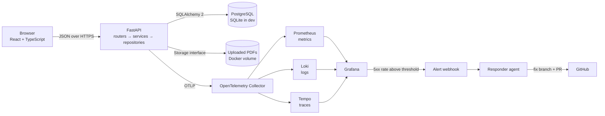
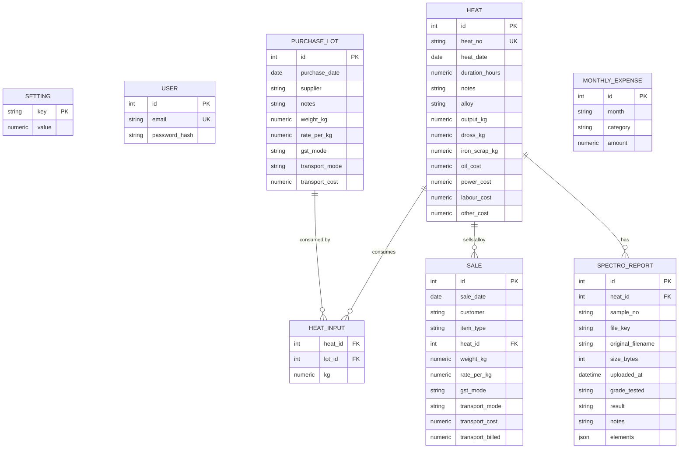
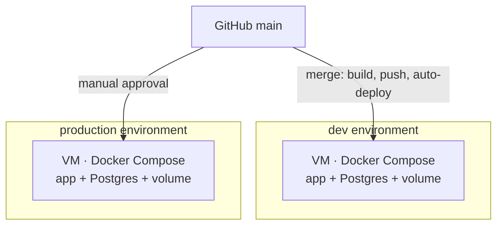

# Architecture

Target architecture for MetalOps Lite. The frozen specification is [`../product-spec.md`](../product-spec.md); this document explains how the code is arranged and why. Sections marked *planned* describe work not yet implemented.

## 1. Shape of the system

One deployable backend, one static frontend, one database, one file volume. No queue, no cache, no extra services: the workload is a single workshop.

## 2. Backend layers

| Layer | Location | Responsibility | Must not |
|---|---|---|---|
| Routers | `app/routers/` | HTTP shape, auth dependency, status codes, request/response schemas | Contain money maths or queries |
| Services | `app/services/` | Use cases, transactions, rules that need database state (R4 stock guard, R9 sale cap) | Build SQL directly |
| Repositories | `app/repositories/` | Queries and persistence only | Decide business policy |
| Calculation | `app/calc.py` | **All** money and weight maths, R2–R12 | Import the database, HTTP, or a model |
| Models | `app/models/` | SQLAlchemy 2 mappings, constraints, relationships | Hold business logic |
| Schemas | `app/schemas/` | Pydantic v2 request/response validation | Touch the database |
| Storage | `app/storage/` | `Storage` interface and `LocalStorage` implementation | Accept a path built from user input |

`calc.py` being pure is the central design decision. Every rule that affects a rupee or a kilogram is a function of values, so the worked example becomes a unit test with no fixtures, and the integration suite can only disagree with it if the wiring is wrong.

### Money and weights

- Python `Decimal` everywhere, never `float`.
- SQLAlchemy `Numeric`, never `Float`.
- Values are quantised to 2 decimal places at the boundary where they are stored or displayed.
- Rates and amounts are **excluding GST**. GST is stored as a derived amount for the estimate only.

## 3. Data model

Derived, never stored as the source of truth:

| Derived value | Rule | Computed by |
|---|---|---|
| `gst_amount` | R2 | `calc.gst_amount` |
| `landed_cost_per_kg` | R3 | `calc.landed_cost_per_kg` |
| `remaining_kg` | lot weight − sum of heat inputs | `calc.remaining_kg` / repository aggregate |
| `yield_pct` | R5 | `calc.yield_pct` |
| `net_outbound_transport` | R6 | `calc.net_outbound_transport` |
| `heat_profit` | R7 | `calc.heat_profit` |
| provisional flag | R8 | `calc.is_provisional` |
| monthly profit | R10 | `calc.monthly_profit` |
| break-even heats | R11 | `calc.break_even_heats` |
| GST estimate | R12 | `calc.gst_summary` |

Storing derived money would create a second source of truth that drifts after every edit. The only stored aggregate is the heat-to-lot kg allocation, because that is an input, not a result.

## 4. Key flows

### Create a heat (R4)

1. Router validates the payload (alloy, output ≥ 0, at least one input, unique `heat_no`).
2. Service opens one transaction.
3. For each input, the repository reads the lot with `FOR UPDATE` (Postgres) and sums existing inputs.
4. If `requested kg > remaining kg`, raise a domain error → **422**, and nothing is written.
5. Insert the heat and its inputs, commit.
6. The response includes computed yield and scrap cost from `calc.py`.

### Upload a spectro report (R13)

1. Router streams the upload with a size cap of 10 MB.
2. Service checks the first bytes equal `%PDF`, not the file extension.
3. `Storage.save()` generates a random key and writes the bytes to the volume.
4. On success, insert the report row; on failure, delete any partial file and return a clear error.
5. Download resolves `file_key` from the database and streams it through an authenticated route. There is no public URL.

### Dashboard month

1. Repository fetches heats, linked sales, unlinked dross/iron sales and expenses for `YYYY-MM`.
2. Service passes plain values into `calc.monthly_profit`, `calc.break_even_heats` and `calc.gst_summary`.
3. Router returns one payload for all KPI cards and charts, so the screen makes one request.

## 5. Frontend

| Concern | Decision |
|---|---|
| Build | Vite, React 18, TypeScript strict |
| Data | All HTTP through `src/api/client.ts`; no component calls `fetch` directly |
| UI | Tailwind CSS and shadcn/ui; charts with Recharts; icons with lucide |
| Money | One shared formatter using `Intl.NumberFormat('en-IN')`; components never hand-format |
| State | Server state per screen; no global store until a second consumer appears |
| Errors | Every screen has loading, empty and error states |
| Theme | Light and dark, stored preference, respects the OS default on first visit |

## 6. Security and privacy

- Session cookie auth; every `/api` route except `/api/health` and login requires a session (issue #11).
- Passwords hashed; the owner account is created from environment variables at startup.
- Downloads are authenticated; file keys are random and never derived from user input.
- Telemetry allow-list: route, method, status, duration, trace and span IDs, heat/report IDs, byte sizes. Never supplier or customer names, rates, amounts, filenames or file contents. A unit test asserts the allow-list (issue #16).
- Secrets only from environment variables; `.env` is git-ignored and `.env.example` lists names without values.

## 7. Deployment topology (planned)

One small VM per environment with Docker Compose is chosen over a PaaS because uploaded PDFs must survive redeploys, which needs a persistent disk. The previous image tag is retained for rollback (issue #15).

## 8. Decisions and their reasons

| Decision | Why |
|---|---|
| `calc.py` pure functions | The money rules are the product; they must be testable without a database |
| Derived values computed, not stored | Avoids drift between stored totals and their inputs |
| SQLite in dev, Postgres in Docker | Zero-setup local loop without pretending it is production |
| Storage interface, local volume first | Uploads survive restarts; a cloud bucket can be added without touching routers |
| One workspace, one role | Stated v1 scope; multi-tenancy would touch every table |
| Estimate, not filing, for GST | The system is not a tax authority and must not imply compliance |
| OpenTelemetry + Collector | Vendor-neutral; Grafana reads metrics, logs and traces with one trace ID |

## 9. Deliberately out of scope

Working-capital planning, multi-year projections, multiple workspaces or roles, PDF text parsing, a mobile app, GST return filing, inventory valuation beyond remaining kg per lot.

## 10. Status

| Component | Issue | State |
|---|---|---|
| Repository, docs, agent process | #19 (partly wave 0) | **Done** |
| Backend/frontend scaffold and commands | #1 | Not started |
| Models, migration, seed | #2 | Not started |
| `calc.py` and unit tests | #3 | Not started |
| Purchases, heats, sales APIs and screens | #4, #5, #6 | Not started |
| Heat history and detail | #7 | Not started |
| Spectro reports and storage | #8 | Not started |
| Expenses and dashboard figures | #9 | Not started |
| Design system and charts | #10 | Not started |
| Authentication | #11 | Not started |
| Integration suite | #12 | Not started |
| Compose stack | #13 | Not started |
| CI and CD | #14, #15 | Not started |
| Observability, alert, responder | #16, #17, #18 | Not started |
