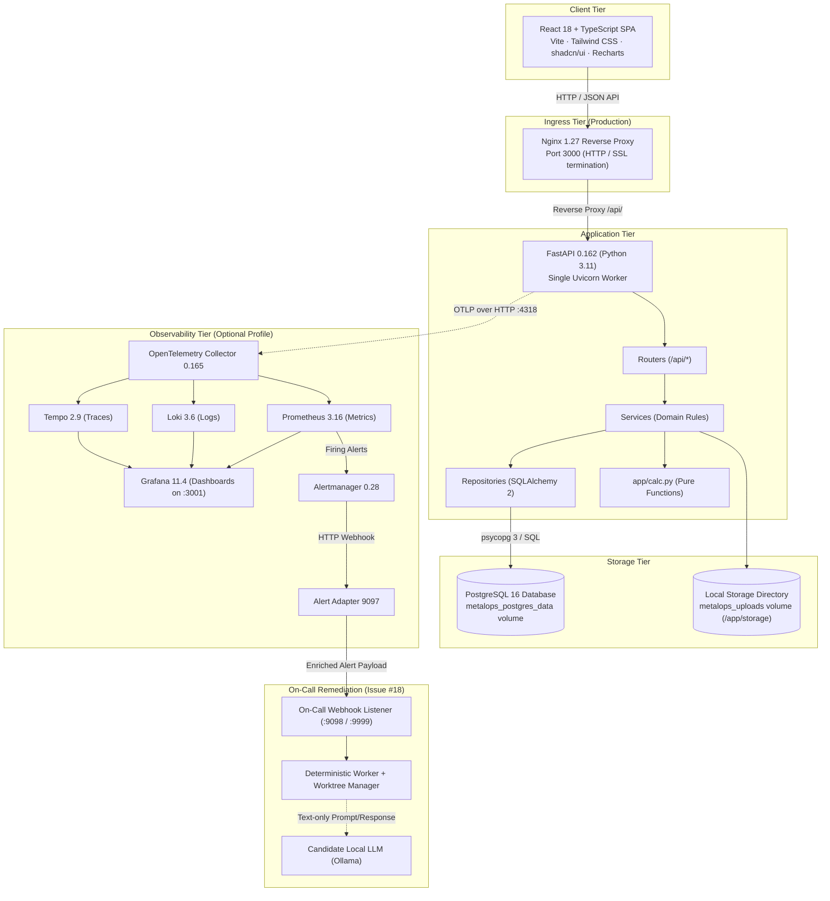
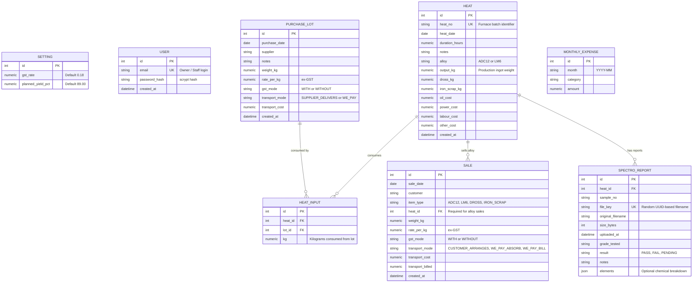
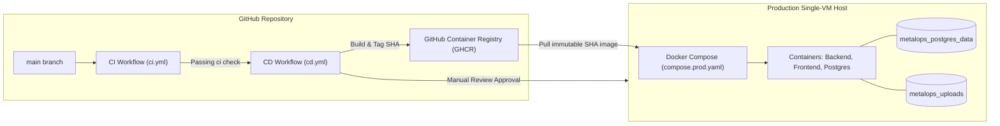

# Architecture

Target and production architecture for MetalOps Lite. The frozen specification is [`../product-spec.md`](../product-spec.md); this document explains how the system is layered, how components communicate, the persistence and security models, and the verified deployment topology.

---

## 1. System Topology & Request Flow

MetalOps Lite is designed as a single-workshop, resource-efficient system. It deliberately avoids asynchronous job queues, distributed message buses, or memory caches to maintain a zero-drift single source of truth.

---

## 2. Backend Layers & Responsibilities

The backend enforces strict separation of concerns across layered modules under `app/`:

| Layer | Path | Responsibility | Prohibited Actions |
|---|---|---|---|
| **Routers** | `app/routers/` | HTTP request/response validation, status codes, route parameters, auth session dependency (`get_current_user`). | Must not perform SQL queries or money/weight calculations. |
| **Services** | `app/services/` | Use cases, transaction orchestration, stateful business validation (R4 stock availability, R9 sale cap vs heat output). | Must not construct raw SQL strings or format HTTP responses. |
| **Repositories** | `app/repositories/` | Data persistence and querying using SQLAlchemy 2 `select()` and ORM models. | Must not enforce business policies or derived calculations. |
| **Calculation Module** | `app/calc.py` | **All** pure money and weight mathematics (R1–R12). Pure Python functions using `Decimal`. | **Zero external dependencies.** Must not import SQLAlchemy, FastAPI, or HTTP modules. |
| **Models** | `app/models/` | SQLAlchemy 2 declarative table mappings, foreign keys, and indexes. | Must not hold domain logic or derived calculations. |
| **Schemas** | `app/schemas/` | Pydantic v2 schemas for request validation and response serialization. | Must not touch the database or filesystem. |
| **Storage** | `app/storage/` | Abstract `Storage` protocol and `LocalStorage` implementation for PDF reports. | Must not accept file paths derived from untrusted user input. |

### Architectural Decision: Pure Calculation Module (`app/calc.py`)
All financial and weight calculations are pure functions of their inputs. They accept and return Python `Decimal` numbers quantised to 2 decimal places with `ROUND_HALF_UP` rounding. Division by zero is explicitly handled, returning `None` (`n/a`) instead of raising exceptions. This guarantees that financial rules can be exhaustively unit-tested without database mocks or fixtures.

---

## 3. Data Model & Entity Relationships

The relational schema is managed through Alembic migrations (`migrations/versions/`) and maps all money and weight columns to `Numeric(12, 2)`:

### Prohibition on Storing Derived Values
To prevent data synchronization drift, the database **never** stores derived metrics:
- `gst_amount`, `landed_cost_per_kg`, and `remaining_kg` are calculated on read via `app/calc.py`.
- `yield_pct`, `heat_profit`, and `is_provisional` are derived on request from inputs, variable costs, and linked sales.
- `monthly_profit`, `break_even_heats`, and `gst_summary` are derived aggregates across monthly cohorts.

---

## 4. Frontend Architecture

The frontend is a single-page application built with React 18 and Vite:
- **Centralized API Client (`src/api/client.ts`)**: Components do not call browser `fetch` directly. All API communication flows through typed helper methods that manage base URLs, session credentials (`credentials: 'include'`), and structured error extraction.
- **UI & Layout**: Styled with Tailwind CSS, using accessible primitives inspired by shadcn/ui. Financial data is visualized with Recharts.
- **Currency & Number Formatting**: All monetary values are rendered through `src/lib/format.ts` using `Intl.NumberFormat('en-IN')` with Indian numbering grouping (lakhs and crores). Hand-formatting numbers in components is strictly forbidden.
- **Theme & Responsiveness**: Supports light and dark modes with system preference fallback, fully responsive from mobile phone screens (375 px) to desktop views.

---

## 5. Security & Isolation Boundaries

1. **Authentication & Session Security**:
   - Authentication relies on HTTP-only, `SameSite=Lax` session cookies. In production, cookies are flagged `Secure`.
   - Passwords are encrypted using Python's `hashlib.scrypt` with a minimum salt length and cost parameters hardened for production security.
2. **File Storage & Path Traversal Prevention**:
   - Spectro reports are stored behind the `Storage` abstraction.
   - Files are saved on disk using randomly generated alphanumeric keys (UUIDs). User-supplied file names are sanitized and stored solely as database metadata.
   - Reports are retrieved strictly through authenticated streaming endpoints (`GET /api/heats/{heat_id}/reports/{id}/download`); no public static file URLs exist.
3. **Telemetry & Privacy Allowlist**:
   - OpenTelemetry instrumentation in `app/telemetry.py` enforces a deny-by-default allowlist.
   - Span attributes, metric labels, and JSON log attributes permit only HTTP routes, methods, status classes, response durations, and internal IDs.
   - Customer names, supplier names, prices, rates, file contents, and passwords are unconditionally scrubbed before reaching OpenTelemetry exporters.

---

## 6. Observability & Alerting Architecture

When the `--profile observability` flag is enabled in Docker Compose:
1. **Tracing & Metrics**:
   - The FastAPI backend exports OTLP telemetry to `metalops-otel-collector:4318`.
   - Traces are forwarded to Grafana Tempo; Prometheus scrapes metrics from the Collector on port 8889; logs are ingested into Grafana Loki.
2. **Alert Pipeline**:
   - Prometheus evaluates the 5-minute ratio alert `HeatReportHigh5xxRate` (`observability/prometheus/alert_rules.yml`).
   - Firing alerts are sent to Alertmanager (`metalops-alertmanager:9093`), which dispatches to `metalops-alert-adapter:9097`.
   - The adapter queries Loki internally to extract up to 5 matching trace IDs and posts an enriched JSON payload to `ALERT_WEBHOOK_URL`.
3. **Host Isolation**:
   - Only Grafana publishes a host port (`127.0.0.1:3001`). Prometheus, Loki, Tempo, Alertmanager, and the Collector remain internal to the Docker Compose network `metalops_network`.

---

## 7. Deployment Architecture & Rollback Strategy

- **Production Topology**: Single VM running Docker Compose (`compose.prod.yaml`) with named volumes ensuring database records and uploaded PDF reports persist across updates and restarts.
- **Immutable Container Tags**: All production images are tagged with git commit SHAs (e.g. `ghcr.io/kushagrapan/metal-ops-backend:<sha>`).
- **Deterministic Rollback**: If an issue occurs in production, rollback is executed by running `IMAGE_TAG=<previous_sha> docker compose -f compose.prod.yaml up -d`, returning to the known-good revision without data loss.

---

## 8. Architectural Decisions & Trade-Offs

| Decision | Selected Approach | Considered Alternative | Reason for Selection |
|---|---|---|---|
| **Calculation Engine** | Pure Python functions with `Decimal` | Stored database procedures or ORM property hooks | Eliminates test dependencies on running databases; prevents calculation drift across concurrent reads. |
| **Currency Representation** | Python `Decimal` / SQL `Numeric(12,2)` | Native IEEE 754 `float` | Binary floating-point arithmetic introduces rounding inaccuracies that distort tax and financial reporting. |
| **Storage Architecture** | Local volume with abstract interface | Direct AWS S3 / Cloud Storage integration | Single-workshop v1 scope keeps deployment footprint low; interface enables cloud migration without modifying routers. |
| **Concurrency Protection** | Database row locking (`FOR UPDATE`) | Optimistic concurrency via version counters | Prevents race conditions during simultaneous heat creations competing for purchase lot stock. |
| **Local Development Database** | SQLite (in-memory / file) | Mandatory local PostgreSQL container | Enables instant developer feedback and fast unit testing without Docker prerequisites. |
| **Single Role Auth** | Session cookies with owner bootstrap | Multi-tenant RBAC / OAuth2 | Matches the verified workshop operating model (shared workshop terminals for owner and furnace staff). |
